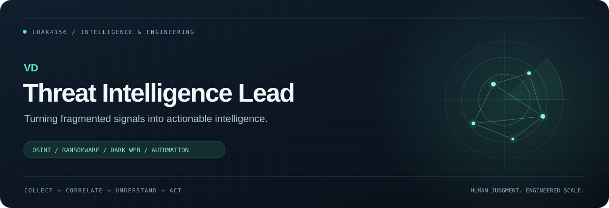

<p align="center">
  
</p>

<p align="center">
  <strong>Threat Intelligence Lead @ CYBEROO</strong><br />
  <sub>Threat research · Intelligence operations · LLM-assisted tooling</sub>
</p>

<p align="center">
  <a href="#about">About</a> &nbsp; / &nbsp;
  <a href="#focus">Focus</a> &nbsp; / &nbsp;
  <a href="#selected-projects">Projects</a> &nbsp; / &nbsp;
  <a href="#toolkit">Toolkit</a> &nbsp; / &nbsp;
  <a href="#credentials">Credentials</a> &nbsp; / &nbsp;
  <a href="https://www.linkedin.com/in/kononow/">LinkedIn</a>
</p>

---

## About

I connect **threat research, intelligence operations, and practical automation** to help analysts make better decisions. My work spans ransomware, dark web intelligence, OSINT, and data breach analysis - with a particular focus on Russian-language open and closed sources.

With **6+ years in cybersecurity**, I have moved from leading SOC operations to building and operationalizing threat intelligence capabilities. Previously, I led a **20-analyst Tier 1 SOC team (2020-2024)**. That operational background shapes the tools I design: useful context, clear priorities, and workflows analysts can actually use.

I use **LLMs to turn my ideas and CTI requirements into working software**. My contribution is domain expertise, defining workflows, guiding development, and evaluating the results in practice.

<table>
<tr>
<td width="33%" valign="top">
<h3>01 / Investigate</h3>
Ransomware activity, dark web ecosystems, exposed data, and open-source signals. Connect the evidence to the threat.
</td>
<td width="33%" valign="top">
<h3>02 / Operationalize</h3>
Turn fragmented collection into enriched intelligence, asset-aware triage, and actionable analyst workflows.
</td>
<td width="33%" valign="top">
<h3>03 / Automate</h3>
Use LLMs to develop tools around real investigation needs. Define the requirements, guide implementation, and assess the results from an analyst’s perspective.
</td>
</tr>
</table>

## Focus

- **Ransomware & dark web intelligence** - track activity across leak sites, forums, and underground sources.
- **OSINT, SOCMINT & HUMINT** - bring technical signals and source context into the same investigation.
- **Exposure & breach analysis** - connect discovered data to affected assets and operational priorities.
- **LLM-assisted tooling** - translate CTI requirements into tools for collection, IOC extraction, deduplication, and alert triage.

## Selected projects

<sub>Private repositories. I define the requirements and workflows, guide development with LLMs, and evaluate the results in practice.</sub>

### 01 / CyberTI

**Cyber Threat Intelligence & Digital Risk Protection** · `Threat_Intel_Platform` · `Private`

A self-hosted, multi-tenant platform built around the full analyst workflow: **collect external threat signals, connect them to an organization’s assets, investigate the evidence, and deliver relevant alerts**. It combines ongoing monitoring with on-demand investigation across dark web forums, Telegram channels, ransomware activity, breach datasets, and phishing infrastructure.

**How it works**

- **Direct source collection** - collects from configured forums and websites, including sources requiring browser sessions and Tor access. Supports operator-assisted login, persistent sessions, onion mirrors, and keyword searches across forums.
- **Asset-aware detection** - extracts indicators, reduces duplicate processing, and matches intelligence against monitored domains, brands, email addresses, IPs, and keywords. Alerts include matched evidence and a rule-based score breakdown.
- **Phishing & brand protection** - combines Certificate Transparency monitoring, phishing feeds, and look-alike domain discovery with DNS, registration, TLS, and web evidence. Supports both continuous monitoring and on-demand squatting investigations.
- **Breach exposure analysis** - imports and searches locally held breach archives, correlates exposed records with monitored domains and email addresses, and generates exposure alerts.
- **Investigation & delivery** - gives analysts evidence, source context, and triage states in one workspace, with client-scoped views and alerts delivered through email, Telegram, and webhooks.
- **Collection operations** - tracks source health, run history, failed jobs, and notification delivery so collection problems can be investigated alongside the intelligence itself.

```text
  COLLECT                    CORRELATE                 INVESTIGATE & DELIVER
  Forums / Tor / Telegram ─┐
  Ransomware / RSS        ─┼─▶ Indicators & context ─┬─▶ Evidence & analyst triage
  Imported breach data   ─┤   Asset matching        ├─▶ Client-scoped workspace
  CT / phishing feeds    ─┘   Explainable scoring   └─▶ Relevant notifications
```

**My contribution:** defining CTI requirements, source and investigation workflows, detection priorities, and the analyst experience; guiding development with LLMs and evaluating the platform in practice.

### 02 / Recon Control Center

**External reconnaissance & attack surface investigation** · `recon-control-center` · `Private`

An investigation console that turns a **domain or IP address into a structured picture of its infrastructure, exposed services, and security posture**. Analysts can run selected modules or a broader reconnaissance workflow, with concurrent background tasks, live progress, and dedicated reports for each investigation area.

**What it investigates**

- **Domains & infrastructure** - DNS records, subdomains, registration data, reverse-IP relationships, hosting networks, and look-alike domains, with source context and wildcard-aware discovery.
- **Network routes & attribution** - combines route measurements with ASN, BGP/RPKI, TLS, and reputation evidence. Separates scanner-side and transit networks from destination infrastructure, and provides relationship graphs, route history, and IOC exports.
- **Web exposure** - profiles technologies, reviews headers, discovers historical URLs and exposed paths, and checks for potential vulnerabilities, exposed configuration, and secrets in JavaScript and public sources.
- **Service & transport security** - examines open services and TLS configuration, grades findings by available evidence, and flags signs of honeypots or deception that could distort the attack surface picture.
- **Email & application checks** - reviews SPF, DMARC, and DKIM, supports focused CMS assessments, and includes a dedicated WAF investigation workflow.

The aim is to bring scattered reconnaissance results into an analyst-readable investigation: **what was observed, how strong the evidence is, what remains unknown, and what deserves follow-up**.

**My contribution:** defining reconnaissance workflows, selecting and refining checks, shaping evidence and false-positive handling, and guiding LLM-assisted development around practical analyst needs.

### 03 / Hydra Fetch

**Multi-head Tor downloader** · `Hydra_Fetch` · `Private`

A purpose-built downloader for retrieving files from **Tor and onion services**, where slow routes, interrupted connections, and large archives make ordinary downloads difficult. It manages a configurable pool of Tor heads and coordinates multiple transfer streams through one local web interface.

**How it works**

- **Multi-head transfers** - distributes file segments across available Tor heads, downloading them concurrently when the source supports verified byte ranges.
- **Adaptive download modes** - tests the source before choosing parallel segments or a single stream. An optional race mode compares live streams, keeps the fastest, and stops redundant transfers within a traffic budget.
- **Validated assembly & resume** - checks file-version identifiers, byte ranges, and segment lengths before assembly. Preserves partial data after interruptions and resumes when the source confirms it is safe.
- **Access & session handling** - handles supported verification pages and allows user-assisted sign-in for protected downloads, with sessions kept locally.
- **Collection workflow** - combines batch queues, file discovery, multipart archive selection, live progress, and SHA-256 fingerprinting.

Designed to make collection over Tor more reliable and use available connections effectively. Actual throughput depends on Tor routes and the source service’s capacity.

**My contribution:** defining the collection requirements and multi-head workflow, guiding implementation with LLMs, and validating behavior in practical download scenarios.

## Toolkit

| Area | Tools & capabilities |
| :--- | :--- |
| **LLM-assisted development** | Requirements · Workflow design · AI coding tools · Practical validation |
| **Intelligence** | OSINT · SOCMINT · HUMINT · Dark web research · Threat hunting |
| **Analysis platforms** | Elasticsearch · Kibana · Siemplify |
| **Security tooling** | Nuclei · Invicti · Acunetix · Hashcat · Honeypots |
| **Infrastructure** | Docker · PostgreSQL · Debian · Ubuntu · Kali Linux · VMware · Hyper-V |
| **AI-assisted analysis** | LLM workflows · Collection enrichment · Analyst triage |

## Research & writing

- **Honeypot research** - deployed a research environment and analyzed attack telemetry with Elasticsearch and Kibana. The work contributed to the Cyberoo 2025 Observatory.
- **Published analysis** - contributions on threat intelligence, phishing, and dark web threats, with research featured in Cybersecurity360, CorCom, and La Repubblica.

[Explore my research and publications on LinkedIn](https://www.linkedin.com/in/kononow/)

**Languages:** Ukrainian · Italian · Russian · English

## Credentials

<p>
  
  
  
</p>

<sub>IntelTechniques OSIP · CompTIA CySA+ · Siemplify SCSA</sub>

---

<p align="center">
  <strong>Better context. Clearer decisions. Stronger defense.</strong><br /><br />
  <sub>Ukrainian &amp; Italian citizen · Threat intelligence &amp; LLM-assisted tooling</sub>
</p>
